# autoControl：STM32／FreeRTOS 控制系統

以 STM32F767ZITx 管理 16 路繼電器、排程與電流保護，並透過 Ethernet、HTTP 和 MQTT TLS-PSK 提供本機與遠端操作。專案包含 MCU 韌體、板上 Web 頁面、Node.js 後端管理台、測試 broker 與桌面工具。

目前是持續開發的硬體控制專案。成功產生 AXF／HEX 只能證明編譯成立；繼電器有效電位、CT 校正、電流保護與叢集行為都需要在對應硬體上驗收，不能直接以軟體測試取代。

## 目錄

- [功能與系統架構](#功能與系統架構)
- [環境與硬體需求](#環境與硬體需求)
- [編譯韌體](#編譯韌體)
- [啟動後端管理台](#啟動後端管理台)
- [本機 Web 與桌面工具](#本機-web-與桌面工具)
- [韌體分層與設定](#韌體分層與設定)
- [驗證與維護](#驗證與維護)
- [常見問題](#常見問題)
- [延伸文件](#延伸文件)

## 功能與系統架構

| 功能 | 責任 |
|---|---|
| 繼電器控制 | 單路及 mask 操作，由共用控制流程進入 GPIO 層 |
| 排程器 | 週排程、啟用、暫停、恢復與通道狀態 |
| ADC／CT | 量測摘要、電流換算與保護判斷 |
| 保護機制 | Trip、鎖定、解鎖、學習與強制停止流程 |
| 區域叢集 | UDP discovery、Master／Member 與節點查詢 |
| 本機 Web | 裝置狀態、繼電器、排程、保護與設定頁面 |
| 雲端管理 | Provisioning、認領、金鑰與 MQTT 命令／ACK |
| 管理台同步 | Live State Cache、詳細查詢快取與 SSE |



圖源：[Mermaid](docs/architecture.mmd)。傳送控制命令、收到 ACK 與確認實際負載狀態是不同階段，UI 與 API 都需保留這個區別。

## 環境與硬體需求

- STM32F767ZI 對應板卡、Ethernet 連線與 ST-LINK 或等效燒錄設備。
- Keil µVision／MDK-ARM；現有工程指定 **ARM Compiler 6.24**。
- 配套 STM32 device pack；硬體初始化來源為 [autoControl.ioc](autoControl.ioc)。
- 繼電器驅動、CT／ADC 電路及可安全測試的負載，腳位以 [board_relay.c](App/Platform/board_relay.c) 和硬體文件為準。
- Node.js 與 npm，用於 `tools/backend-test`；該套件未宣告最低 Node 版本。
- Python，用於 Web 資產重建與桌面 GUI；GUI 使用 Python 的 Tkinter。

## 編譯韌體

1. 用 Keil 開啟 [MDK-ARM/autoControl.uvprojx](MDK-ARM/autoControl.uvprojx)。
2. 選擇 `autoControl` target，確認 device 為 `STM32F767ZITx`、編譯器為 ARMCLANG 6.24。
3. 執行 Rebuild，檢查完整 Build Output。
4. 預期輸出位於 `MDK-ARM/autoControl/`，包含對應 AXF／HEX；實際以工程輸出設定為準。

需要命令列建置時，從倉庫根目錄執行，先把 `keilExe` 換成自己的安裝位置：

```powershell
$keilExe = 'C:\Keil_v5\UV4\UV4.exe'
& $keilExe -r MDK-ARM\autoControl.uvprojx -t autoControl -j0 -o keil-build.log
```

`-r` 為重建，`-j0` 關閉命令列建置後的 IDE。請檢查 log 內的 errors／warnings 和輸出時間，不能只根據視窗消失判定成功。燒錄之前先確認 GPIO 極性，並讓實際負載處於可安全停止的狀態。

## 啟動後端管理台

管理台與 broker 是**兩個獨立程式**。`npm start` 不會自動啟動 broker；舊工具文件中合併描述的三個 port，需以下兩個終端一起建立。

先安裝：

```powershell
npm ci --prefix tools/backend-test
```

管理台終端：

```powershell
$env:HTTP_HOST = '127.0.0.1'
$env:HTTP_PORT = '4300'
$env:DASHBOARD_USER = 'local_admin'
$env:DASHBOARD_PASSWORD = 'replace_with_local_password'
npm start --prefix tools/backend-test
```

Broker 終端：

```powershell
$env:MQTT_CONTROL_HOST = '127.0.0.1'
$env:MQTT_CONTROL_PORT = '4301'
$env:MQTT_HOST = '127.0.0.1'
$env:MQTT_PORT = '8883'
npm run mqtt --prefix tools/backend-test
```

管理台位址為 `http://127.0.0.1:4300/`，控制 API 為 `4301`，MQTT TLS-PSK 為 `8883`。要讓實體 MCU 連入，需把 broker 的 bind host 與 MCU 的 broker 位址改成可達的介面，並建立裝置 PSK、身分與群組設定。

| 設定 | 用途 |
|---|---|
| `DASHBOARD_USER`、`DASHBOARD_PASSWORD` | 管理台登入，部署時需改掉程式內的開發預設 |
| `CLOUD_BROKER_HOST`、`CLOUD_BROKER_PORT` | Provisioning 回傳給裝置的 broker 位置 |
| `BACKEND_KEY`、`REMOTE_CLUSTER_PASSWORD` | 後端與叢集相關設定，應使用自己的值 |
| `LIVE_STATE_FRESH_MS`、`LIVE_STATE_STALE_MS` | 狀態新鮮與過期的判定區間 |
| `REMOTE_QUERY_CACHE_*` | 詳細查詢快取；與 MCU 實際狀態需分開判讀 |
| `ALLOW_PRIVATE_KEY_EXPORT` | 私鑰匯出控制，勿因本機測試而在公開部署啟用 |

後端的 `tools/backend-test/data/` 保存金鑰、裝置與群組等資料。備份它時要視為敏感資料；反向代理與防火牆設定不包含在 `npm start` 的流程內。

## 本機 Web 與桌面工具

MCU Web 原始碼位於 [Web/index.html](Web/index.html)，嵌入韌體的資產為 [Web/web_assets.h](Web/web_assets.h)。修改 HTML 後，在根目錄執行：

```powershell
python tools/regen_web.py
```

這會重寫 `web_assets.h`，接著需重新編譯及燒錄。只改 HTML 而沒重建嵌入資產，板上的畫面不會更新。

桌面 GUI 可以用來進行 discovery、HTTP 操作與既有 TCP 指令測試：

```powershell
python tools/autocontrol_gui.py
```

GUI 打包方式請看 [tools/README.md](tools/README.md)。它是維護工具，不能將舊 TCP 指令可用性推論為目前雲端控制傳輸方式。

## 韌體分層與設定

| 路徑 | 責任 |
|---|---|
| [Core](Core) | HAL 初始化、FreeRTOS、系統入口與中斷 |
| [App/Platform](App/Platform) | 板卡繼電器 GPIO，通道數為 16 |
| [App/Domain](App/Domain) | 繼電器與 CT 的領域邏輯 |
| [App/Service](App/Service) | 控制佇列、排程、保護、ADC、HTTP、MQTT、叢集與儲存 |
| [App/Proto](App/Proto) | Discovery 與控制通訊格式 |
| [App/Config](App/Config) | 裝置設定及 RTC backup layout |
| [LWIP](LWIP)、[MBEDTLS](MBEDTLS) | 網路與 TLS 的整合 |
| [MDK-ARM](MDK-ARM) | Keil 工程、啟動與輸出設定 |
| [tools/backend-test](tools/backend-test) | 後端管理台與測試 MQTT broker |

CubeMX 重新產生程式前需檢查 `USER CODE` 區與專案整合。新增 C／H 檔案時，也要確認 Keil 工程已納入編譯，不能只把檔案放進資料夾。

## 驗證與維護

建議依「編譯 → 本機管理台 → 單板 → 叢集 → 遠端命令」逐層驗證：

1. Rebuild 產生有效 AXF／HEX，記錄 errors／warnings。
2. 管理台能登入，空設備清單可顯示且 API 不報未處理例外。
3. 單路繼電器、mask、手動停止與狀態上報一致。
4. CT 零點、倍率、學習與故障保護在受控負載下驗證。
5. 排程的時間同步、啟用、暫停、恢復及重啟後持久化符合預期。
6. Master／Member 的 discovery、斷線恢復、命令 ACK 與查詢快取有效。

MQTT smoke 指令位於 `npm run mqtt:smoke --prefix tools/backend-test`，會對 broker 進行實際連線，需先準備對應測試身分；不要對正式設備無條件執行。其他 C 測試原始碼放在 [tools](tools)，不代表已有統一自動測試入口。

## 常見問題

| 現象 | 優先檢查 |
|---|---|
| AXF 沒有更新 | target、ARMCLANG 版本、device pack 與 Build Output |
| 管理台有畫面但裝置一直離線 | broker 是否獨立啟動、PSK 與 group／node 綁定 |
| 送出命令後狀態不變 | publish、ACK、MCU 實際輸出和 live cache 新鮮度 |
| 詳細設定頁 timeout | MQTT request-response、Member 可達性與快取狀態 |
| Web 與 HTML 原始碼不同 | `regen_web.py`、重編與燒錄是否都完成 |
| 電流保護誤觸發 | CT 接線、倍率、零點、有效量測狀態與學習紀錄 |

## 延伸文件

- [完整系統架構](docs/ARCHITECTURE.md)
- [後端即時狀態與快取](docs/BACKEND_LIVE_STATE_CACHE.md)
- [雲端群組模型](docs/CLOUD_CLUSTER_MODEL.md)
- [MCU Web 版面](docs/MCU_WEB_LAYOUT.md)
- [後端管理台版面](docs/BACKEND_DASHBOARD_LAYOUT.md)
- [後端管理台詳細說明](tools/backend-test/README.md)
- [桌面工具](tools/README.md)

延伸文件可能保留較早的分支名稱、部署網址與開發預設值；目前行為應再對照工程與程式，不把歷史部署示例當成現場驗收證據。

## 專案倉庫

本倉庫：[Du121793/remote-relay-control](https://github.com/Du121793/remote-relay-control)。

這個元件屬於魚塭監控與控制系統，各服務獨立部署，透過 API 或設備通訊整合。

| 元件 | 責任 |
|---|---|
| [water-quality-sensing](https://github.com/Du121793/water-quality-sensing) | ESP32 水質感測與量測上傳 |
| [remote-relay-control](https://github.com/Du121793/remote-relay-control) | STM32 遠端繼電器與設備控制 |
| [pond-monitoring-api](https://github.com/Du121793/pond-monitoring-api) | 魚池資料、權限與告警 API |
| [water-quality-rag](https://github.com/Du121793/water-quality-rag) | 水質論文 RAG 與魚池資料問答 |
| 魚塭前端 | 監控介面與管理操作，發布網址待確認 |

測試後端的金鑰儲存結構可參考 [example.keys.json](tools/backend-test/example.keys.json)。實際金鑰由本機測試／註冊流程產生，`tools/backend-test/data/` 不提交。

## 本機私有設定

公開倉庫只提供範例設定。實際 `.env`、API token、Wi-Fi 密碼、裝置金鑰和私有設定檔保留在本機，範例占位值必須換成自己的設定才能使用相應服務。
